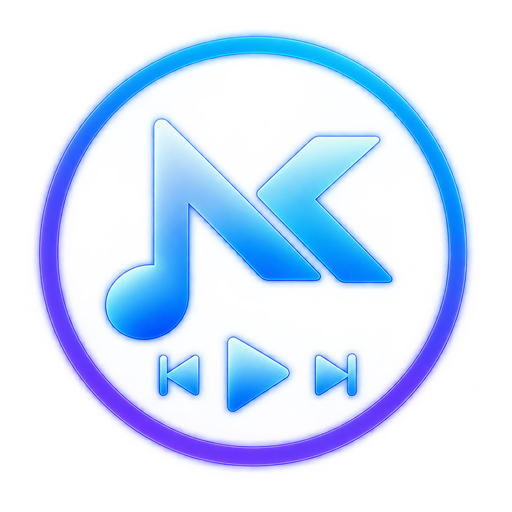

# NK Player

Музыкальный плеер для ВКонтакте на базе Electron.



## Возможности

- Авторизация через QR-код ВКонтакте прямо в окне приложения
- Полная библиотека аудиозаписей, плейлисты, поиск
- **Пауза по клику** — клик по текущему треку ставит на паузу / возобновляет
- **Аватар и имя аккаунта** в боковой панели
- **10-полосный эквалайзер** (31 Гц – 16 кГц) с 7 пресетами и предусилителем
- **Локальная музыка** — импорт MP3/FLAC/WAV/OGG с чтением ID3-тегов и обложек
- **Статус в Discord** — что играет, с обложкой и прогрессом; отключается кнопкой `DC`
- **Кастомный фреймлесс-тайтлбар** в цвете приложения

## Статус в Discord

При воспроизведении NK Player показывает в профиле Discord строку «Слушает NK Player»
с исполнителем, названием трека и полосой прогресса.

- Работает только с десктопным клиентом Discord на той же машине
- Если Discord не запущен, приложение продолжает работать и подключается само, когда клиент появится
- Отключается кнопкой `DC` в правом нижнем углу; выбор запоминается

Чтобы собрать со своим Discord-приложением, замените `CLIENT_ID` в `discord-rpc.js`
на Application ID из [Developer Portal](https://discord.com/developers/applications).
Картинки статуса берутся из Rich Presence → Art Assets с ключами `nk_logo`, `nk_play`, `nk_pause`.

## Скриншоты

<!-- Добавьте скриншоты сюда -->

## Установка (готовый установщик)

Скачайте `NK-Player-Setup-1.3.0.exe` со страницы [Releases](../../releases) и запустите.

- Установка для текущего пользователя, без прав администратора
- Создаёт ярлыки на рабочем столе и в меню «Пуск»
- Данные профиля хранятся в `%APPDATA%\NK Player`

## Сборка из исходников

**Требования:** Node.js 18+, npm

```bash
# Установить зависимости
npm install

# Запустить в режиме разработки
npm start

# Собрать установщик (Windows x64)
npm run build
```

Готовый установщик появится в `dist/NK-Player-Setup-1.3.0.exe`.

## Структура проекта

```
├── main.js          # Главный процесс Electron (окно, IPC, миграция профиля)
├── renderer.js      # Рендер-процесс (UI, очередь, эквалайзер, локальная музыка)
├── vk-audio.js      # Работа с API ВКонтакте (треки, профиль, HLS)
├── local-music.js   # Импорт и хранение локальных файлов
├── discord-rpc.js   # Статус «Слушает» в Discord
├── index.html       # Разметка и стили
└── assets/
    ├── icon.ico     # Иконка приложения
    └── icon.png     # Иконка для UI
```

## Технологии

- [Electron](https://www.electronjs.org/) 44
- [hls.js](https://github.com/video-dev/hls.js/) — воспроизведение HLS-потоков ВКонтакте
- [@xhayper/discord-rpc](https://github.com/xhayper/discord-rpc) — Rich Presence
- Web Audio API — эквалайзер
- Node.js `fs` — хранение локальной музыки

## Лицензия

[MIT](LICENSE)
